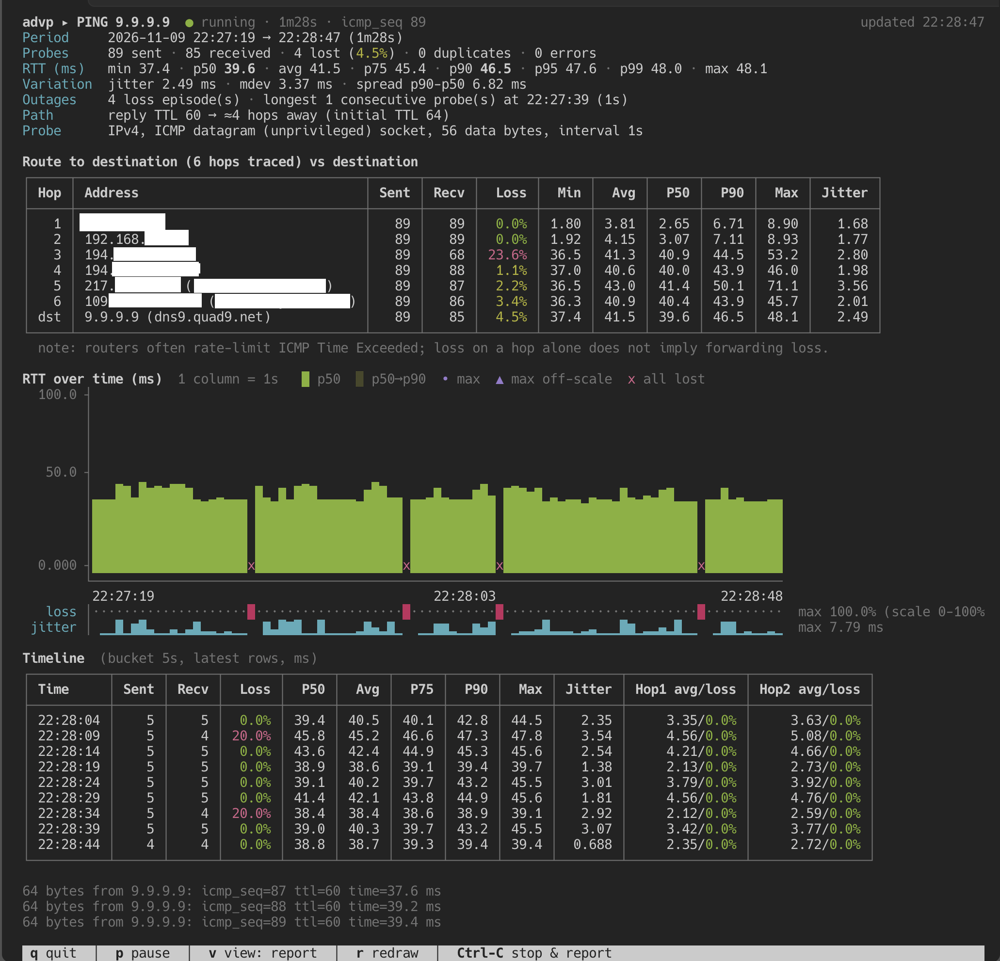

# advp — advanced ping

> [!CAUTION]
>
> ## ⚠️ WARNING: THIS IS VIBECODED SOFTWARE ⚠️
>
> **This project was written using an LLM ("vibecoded").
>
> - **Provenance:** like every LLM-produced artifact, this code was generated by
>   models trained on other people's work (code, text, documentation) taken
>   without consent, credit or compensation. The authors of that work are not
>   acknowledged here.
> - **Quality:** human review is not a guarantee of correctness. Use it at your
>   own risk, especially with raw sockets and elevated privileges.
> - **Environmental cost:** the coding session that produced this project made
>   about **250 model requests** (including one code-review sub-agent). Each
>   request re-reads the whole conversation, which grew past 250k tokens, so the
>   session processed roughly **30 – 45 million input tokens** (mostly cached)
>   and generated about **0.3 – 0.45 million output tokens** (code, tests,
>   workflows, commands, reasoning). These are estimates reconstructed by the
>   model itself, not metered values. Rough cost (inference only, excluding
>   model training and hardware manufacturing; real values vary widely by model
>   and datacenter):
>
>   | Resource | Estimate for this session |
>   |----------|---------------------------|
>   | Energy   | ~ 1.8 kWh            |
>   | CO₂      | ~ 0.7 kg CO₂e        |
>   | Water    | ~ 3 L                |
>
>   That is roughly 3 – 18 electric-kettle boils, or one to two dishwasher
>   cycles.

`advp` is a drop-in replacement for iputils `ping` written in Go. It
supports most of the GNU/Linux `ping` command line and prints the same
per-reply lines and summary. When the run ends it adds a report covering
the whole session:

- **Overall stats**: sent, received, lost, duplicates, errors; RTT min, p50, avg, p75,
  p90, p95, p99 and max; jitter (mean |ΔRTT|, RFC 3550 style); mdev;
  loss episodes and the longest outage; hop distance estimated from the reply TTL.
- **First hops**: probes with TTL=1..N (default 2) run alongside the main ping.
  Each hop shows its address(es) and reverse DNS name, plus loss, RTT
  percentiles and jitter. Route changes are detected.
- **Whole route** (`--hops-max`): a parallel traceroute runs before the ping
  starts, then every hop up to the destination is monitored the same way.
  See [Route discovery](#route-discovery).
- **Timeline table**: one row per time bucket from start to exit, with
  loss, latency percentiles, jitter and per-hop latency/loss.
- **Terminal charts**: an RTT chart (p50 bars, p50→p90 band, max markers,
  fully lost columns), plus sparklines for loss, jitter and each hop.
- **Live report** (`--live`): instead of per-packet lines, a full-screen version
  of the final report (summary, hops, RTT chart, timeline) that is redrawn on
  every packet sent and received. See [Live view](#live-view).
- **Exports**: `--csv` writes every probe; `--html` writes a self-contained
  report with SVG charts that show values on hover.

## Screenshot



*`advp --live --hops-max 9.9.9.9` after 1m28s: the summary, the traced route
compared with the destination (hop addresses redacted), the RTT chart with loss
and jitter sparklines, the latest timeline rows and the last replies. Press
`v` to switch view, `q` to quit and print the full report.*

## Install / build

```sh
go install github.com/mbovo/advp/cmd/advp@latest   # or
just build                                          # → bin/advp
```

Prebuilt binaries for each tagged release are on the GitHub Releases page.
Supported on Linux and macOS.

## Privileges

`advp` first tries an unprivileged ICMP datagram socket:

- **macOS**: works out of the box, including the hop probes.
- **Linux**: needs your group in `net.ipv4.ping_group_range`, e.g.
  `sudo sysctl -w net.ipv4.ping_group_range="0 2147483647"`. ICMP
  errors (TTL exceeded, unreachable) are read from the socket error
  queue (`IP_RECVERR`).

If the datagram socket fails, or you run as root (or with
`sudo setcap cap_net_raw+ep ./advp`), it uses a raw socket. Like iputils,
non-root users cannot use intervals below 2 ms or a preload above 3.

## Usage

```sh
advp 1.1.1.1                       # like ping, Ctrl-C prints summary + report
advp -c 100 -i 0.2 example.com     # 100 probes, 200 ms apart
advp -w 600 --live example.com     # 10-minute live report
advp -q -w 3600 --html net.html --csv net.csv 8.8.8.8   # 1-hour unattended capture
advp --hops 4 --bucket 1m gw.lan   # watch 4 hops, 1-minute timeline rows
advp --hops-max --live example.com # trace the route, then watch every hop live
```

Ctrl-C (SIGINT/SIGTERM) stops and prints the report. Ctrl-\ (SIGQUIT)
prints a one-line status, as in iputils.

### iputils options

| Option | Meaning | Notes |
|---|---|---|
| `-c count` | stop after *count* replies | |
| `-i interval` | seconds between packets | |
| `-W timeout` | time to wait for a response | linger after the last probe |
| `-w deadline` | stop after *deadline* seconds | |
| `-s size` | data bytes | |
| `-t ttl` | IP TTL / hop limit | |
| `-l preload` | send *preload* packets at once | |
| `-f` | flood ping | |
| `-A` | adaptive ping | |
| `-q` / `-v` | quiet / verbose | |
| `-n` / `-H` | numeric / force reverse DNS | |
| `-D` | timestamps | |
| `-a` | audible | |
| `-O` | report outstanding replies | |
| `-3` | full RTT precision | |
| `-p pattern` | padding pattern (hex) | |
| `-Q tos` | TOS / traffic class | |
| `-I iface\|addr` | interface or source address | `SO_BINDTODEVICE` on Linux, `IP_BOUND_IF` on macOS |
| `-m mark` | `SO_MARK` | Linux only |
| `-M do\|dont\|want\|probe` | PMTU discovery | macOS supports only `do` and `dont` |
| `-S size` | `SO_SNDBUF` | |
| `-e id` | ICMP identifier | |
| `-b` | allow broadcast | |
| `-r` | `SO_DONTROUTE` | |
| `-L` | no multicast loopback | |
| `-d` | `SO_DEBUG` | |
| `-C` | `connect()` the socket | |
| `-R` | record route | IPv4, needs a raw socket |
| `-4` / `-6` | force the IP family | |
| `-B`, `-U` | sticky source, user latency | accepted; no effect |
| `-T`, `-F`, `-N` | timestamp option, flow label, node info | accepted with a warning, not implemented |

Exit codes match iputils: `0` if replies were received, `1` if none were
(or fewer than `-c` before the `-w` deadline), `2` on other errors.

### advp extensions

| Option | Meaning |
|---|---|
| `--live` (aliases `--tui`, `--dashboard`) | full-screen live report, redrawn on every packet |
| `--hops N` / `--no-hops` | number of first hops to probe (default 2) |
| `--hops-max[=N]` | trace the route first (max N hops, default 30), then monitor every hop before the destination; overrides `--hops` |
| `--hop-interval D` | hop probe interval (default `max(1s, -i)`) |
| `--bucket D` | timeline row width (default: auto, about 20 rows) |
| `--chart-height N` | RTT chart rows (default 10) |
| `--csv FILE` | per-probe CSV (target and hops) |
| `--html FILE` | HTML report with SVG charts |
| `--no-report` | classic ping summary only |
| `--color auto\|always\|never`, `--no-color` | ANSI colors (honours `NO_COLOR`) |

Durations accept Go syntax (`500ms`, `1m30s`) or seconds (`0.5`).

## Route discovery

`--hops-max` (or `--hops-max=N`; N is 1-64, default 30) runs a traceroute
before the ping starts. It sends 3 ICMP echo probes with each TTL from 1 to N,
all TTLs in parallel, so discovery takes about 1.5 s whatever the path length.
The result is printed in traceroute format:

```
traceroute to one.one.one.one (1.1.1.1), 30 hops max, 3 probes per hop
 1  router.lan (192.168.1.254)  1.912 ms  1.402 ms  1.377 ms
 2  * * *
 3  100.64.0.1  9.810 ms  10.204 ms  9.931 ms
 4  one.one.one.one (1.1.1.1)  12.120 ms  11.902 ms  12.044 ms  (destination)
→ destination reached at hop 4; monitoring hops 1-3 every 1s
```

The path ends at the first TTL answered by the destination. If a router
returns an ICMP unreachable instead (`!H`, `!N`, `!X`…), the path ends at that
router and it is still monitored. If the destination never answers, every hop
up to the last one that replied is monitored.

Those hops are then probed every `--hop-interval` for the whole session, and
they appear in the hop table, the per-hop timeline columns, the sparklines and
the CSV/HTML exports. During the session, a line is printed only when a hop
answers from an address not seen before (a route change or a new ECMP path).
With `-q` only the `→` summary line is printed.

## Live view

`advp --live <host>` opens a full-screen view on the terminal's alternate
screen in place of the per-packet lines. It shows the same sections as the
final report (summary, first hops, RTT chart with loss/jitter/hop sparklines,
the latest timeline rows) plus the most recent replies. It is redrawn after
every probe sent and every reply or ICMP error. Frames are paced
adaptively (at least 20 ms apart, more if drawing is slow), so `-f` floods
don't overload the terminal, and the view follows terminal resizes.

| Key | Action |
|---|---|
| `q`, `Esc`, `Ctrl-C` | stop; the classic summary and the full report are printed to the normal screen |
| `p`, `Space` | pause/resume redrawing (probing and statistics continue) |
| `v`, `Tab` | switch view: report (chart + table) → chart (all hop sparklines) → table → hops (per-hop table, mtr style) |
| `r`, `Ctrl-L` | clear and redraw |

If stdout is not a terminal, `--live` falls back to normal line output.

## Notes on the statistics

- A probe counts as **lost** once it has had no answer for `-W` (or
  ~2×max RTT, at least 1 s). Younger probes count as *in flight*, so the
  live view doesn't report false loss.
- **Jitter** is the mean absolute difference between consecutive RTTs.
  **mdev** is the standard deviation, as in iputils.
- Percentiles use linear interpolation between closest ranks.
- Many routers rate-limit ICMP Time Exceeded replies. Loss seen only
  on a hop does not mean forwarded traffic is being lost.

## Development

You need Go (see `go.mod`) and [just](https://github.com/casey/just). The
recipes don't need any other tool installed: they always use the versions
pinned in the `justfile`, which are the same as CI.

- **golangci-lint v2** runs through `scripts/golangci-lint.sh`. It uses the one
  on your PATH if it is exactly the pinned version. Otherwise it installs the
  pinned version once into `~/.cache/advp/`.
- **govulncheck, GoReleaser and actionlint** run with `go run <tool>@<version>`.
  They are downloaded and cached by Go the first time.

To use specific binaries instead, set `GOLANGCI_LINT`, `GOVULNCHECK`,
`GORELEASER` or `ACTIONLINT` to their paths. `just tools` installs the pinned
versions into `$GOBIN` if you also want them on your PATH. Then:

| Recipe | What it does |
|---|---|
| `just build` / `just run -c 5 1.1.1.1` | build `bin/advp` with version info / build and run it |
| `just install` | `go install` with version info |
| `just cross` | cross-compile linux/darwin × amd64/arm64 into `dist/` |
| `just test`, `just test-race` | unit tests (`just test -run Pinger -v` passes flags through) |
| `just smoke` | end-to-end smoke tests against the built binary |
| `just test-scripts` | tests for the release scripts |
| `just test-all` | unit + script + smoke tests |
| `just cover`, `just cover-html` | coverage summary / browser report |
| `just ping-loopback` | quick manual ping of 127.0.0.1 with the built binary |
| `just fmt`, `just fmt-check` | gofmt + goimports |
| `just vet`, `just lint`, `just lint-fix` | `go vet` and golangci-lint, run once per GOOS (darwin and linux) |
| `just lint-ci` | actionlint for the workflows, shellcheck for the scripts |
| `just vuln` | govulncheck |
| `just tidy`, `just tidy-check` | `go mod tidy` |
| `just check` | pre-push gate: fmt, tidy, vet, lint, race tests, script tests, cross build |
| `just setcap`, `just ping-group` | Linux: grant `cap_net_raw` / enable ping sockets (sudo) |
| `just next-version` | version the next merge to `main` would release |
| `just release-check`, `just release-snapshot` | validate the GoReleaser config / build a local snapshot into `dist/` |
| `just tag v1.2.3` | tag and push a release by hand |
| `just clean` | remove build output |

### Tests

- **Unit tests** (`just test-race`) need no privileges or network. The engine
  and the CLI run against a simulated network (`internal/icmptest`) that
  produces replies, loss, duplicates, ICMP errors, send failures and route
  changes.
- **Real-socket tests** in `internal/icmp` ping 127.0.0.1 and ::1. They skip
  when ICMP sockets are not allowed. Set `ADVP_REQUIRE_ICMP=1` to make them fail
  instead (CI does).
- **Smoke tests** (`just smoke`, build tag `smoke`, in `test/smoke`) run the
  compiled binary end to end:
  - version, help and every usage error with its exit code;
  - IPv4 and IPv6 loopback pings and packet options;
  - `-q`, `-l`, `-w`, `-f`;
  - hop probing and `--hops-max` route discovery;
  - CSV and HTML exports;
  - SIGQUIT and SIGINT;
  - the `--live` view driven through a pty with `script(1)`.

  Set `ADVP_BIN=/path/to/advp` to test a prebuilt binary, e.g. a release
  artifact. On Linux, ICMP needs
  `sudo sysctl -w net.ipv4.ping_group_range="0 2147483647"` (`just ping-group`).

### CI and releases

| Workflow | Trigger | What it does |
|---|---|---|
| `ci.yml` | push to any branch except `main`; pull request opened, updated or reopened | runs `test.yml` |
| `test.yml` | called by the other two | lint (darwin + linux), unit tests and smoke tests on Ubuntu and macOS with real ICMP, shellcheck + release-script tests, govulncheck, GoReleaser snapshot build (artifacts kept 7 days) |
| `release.yml` | push to `main` (i.e. a merge), push of a `v*` tag, manual run | runs `test.yml`, then tags and publishes a GitHub release with GoReleaser |

On `main`, `scripts/next-version.sh` computes the next version from the
[Conventional Commits](https://www.conventionalcommits.org/) since the last
`vX.Y.Z` tag:

| Commits since the last tag | Release |
|---|---|
| `type!:` subject or `BREAKING CHANGE:` footer | major (minor while < v1.0.0) |
| `feat:` | minor |
| `fix:`, `perf:`, `refactor:`, or any non-conventional subject | patch |
| only `docs:`, `test:`, `ci:`, `chore:`, `style:`, `build:` | no release |
| `[skip release]` in the message | commit ignored |

Merge commits are ignored, so the PR's commits (or the squash-merge title)
decide the version. The workflow pushes the tag and GoReleaser publishes:

- tar.gz archives for linux/darwin × amd64/arm64;
- deb, rpm and apk packages, whose post-install grants `cap_net_raw`;
- checksums and a grouped changelog.

To choose a version yourself, push a tag (`just tag v1.0.0`). The workflow
releases it as is, and later automatic releases continue from it. Run
`just next-version` to preview what the next merge would release.

### Layout

```
cmd/advp/            main package (thin wrapper around internal/cli)
internal/cli/        iputils-compatible option parsing, resolution, socket setup
internal/ping/       ping engine: scheduling, reply matching, hop probes, iputils output
internal/icmp/       ICMP encode/decode and sockets (socket_linux.go, socket_darwin.go)
internal/icmptest/   simulated icmp.Conn used by the unit tests
internal/stats/      samples, loss/percentile/jitter aggregation, time buckets
internal/report/     terminal report and charts, live view, CSV and HTML export
internal/tty/        terminal cbreak mode and key decoding for the live view
internal/version/    build metadata injected with -ldflags (falls back to VCS info)
test/smoke/          end-to-end tests of the built binary (build tag "smoke")
scripts/             next-version.sh (release versioning) and its tests
packaging/           Linux package scripts (post-install setcap)
.github/workflows/   ci.yml, test.yml, release.yml (see above)
```
